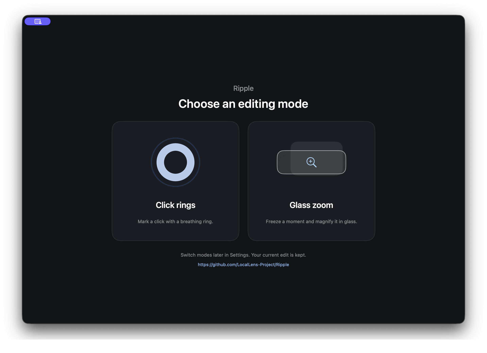
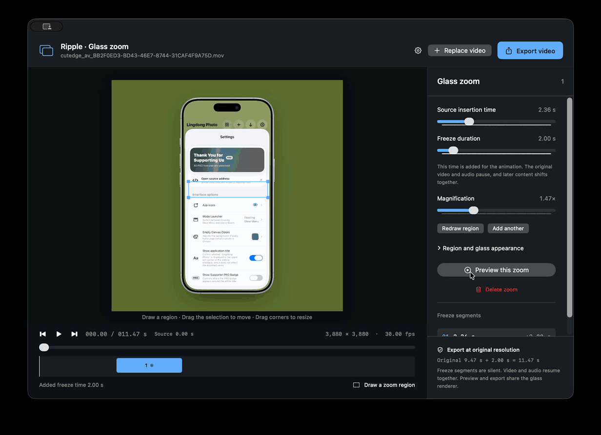

<h1 align="center">Ripple</h1>

Language ➡️ <a href="README.zh-Hans.md">简体中文</a>

Ripple is a lightweight macOS video editor with breathing click rings and glass zoom effects. Place a ring or select a region to add a freeze-and-zoom effect. Export at the original resolution with matching preview effects, with support for English and Simplified Chinese.

<h2 align="center">Click rings</h2>

<h2 align="center">Glass zoom</h2>

